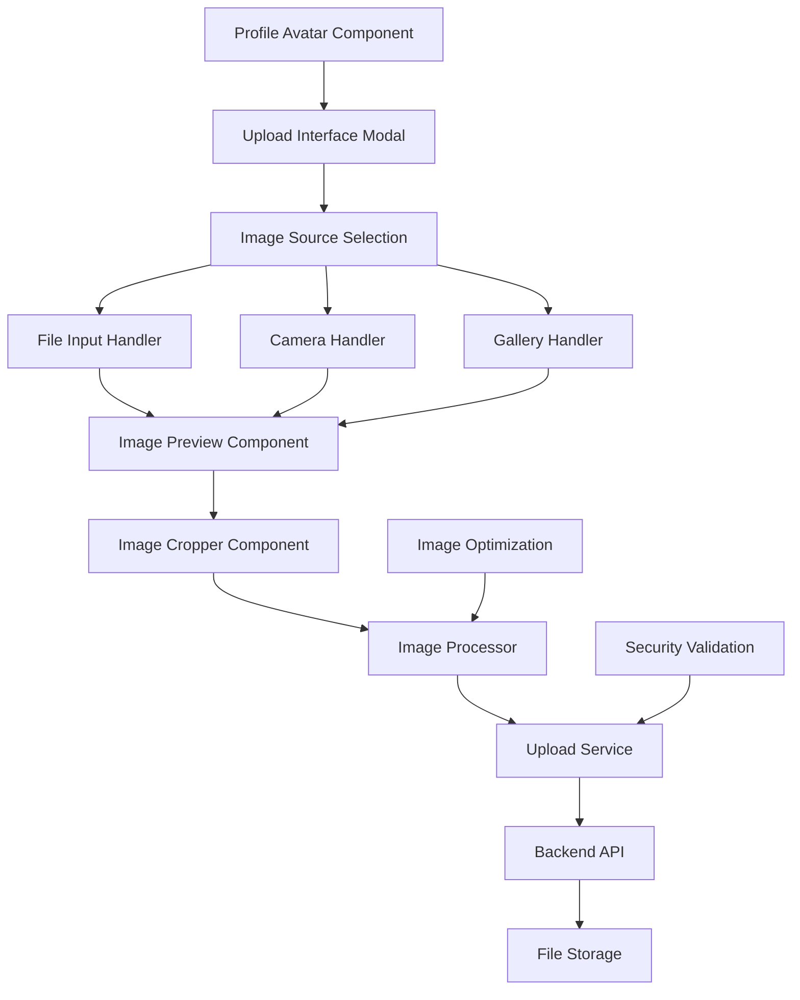

# Design Document: Profile Image Management

## Overview

The Profile Image Management system enhances the MediCare application by providing users with a comprehensive interface for uploading, editing, and managing their profile pictures. The system integrates seamlessly with the existing React/TypeScript frontend and Node.js backend, offering multiple upload methods, advanced image editing capabilities, and optimized image processing.

The design emphasizes user experience through intuitive interfaces, real-time previews, and responsive design that works across all devices. Security and performance are prioritized through client-side image optimization, server-side validation, and secure file handling.

## Architecture

### High-Level Architecture



### Component Hierarchy

```
ProfileImageManager/
├── ProfileAvatar (existing, enhanced)
├── UploadInterface/
│   ├── SourceSelectionModal
│   ├── FileInputHandler
│   ├── CameraHandler
│   └── GalleryHandler
├── ImagePreview/
│   ├── PreviewDisplay
│   └── ImageMetadata
├── ImageCropper/
│   ├── CropperCanvas
│   ├── CropControls
│   └── PreviewPanel
├── ImageProcessor/
│   ├── CompressionEngine
│   ├── FormatConverter
│   └── SizeGenerator
└── UploadService/
    ├── ValidationHandler
    ├── ProgressTracker
    └── ErrorHandler
```

## Components and Interfaces

### 1. ProfileAvatar Component (Enhanced)

**Purpose**: Display the user's profile picture with upload trigger functionality.

**Props Interface**:
```typescript
interface ProfileAvatarProps {
  user: User;
  size?: 'small' | 'medium' | 'large';
  editable?: boolean;
  onImageUpdate?: (imageUrl: string) => void;
  className?: string;
}
```

**Key Features**:
- Circular avatar display with fallback to user initials
- Camera icon overlay on hover (when editable)
- Click handler to trigger upload interface
- Responsive sizing based on context
- Loading state during image updates

### 2. UploadInterface Component

**Purpose**: Modal interface for selecting image source and managing upload flow.

**Props Interface**:
```typescript
interface UploadInterfaceProps {
  isOpen: boolean;
  onClose: () => void;
  onImageSelected: (file: File) => void;
  currentImageUrl?: string;
  maxFileSize?: number;
  acceptedFormats?: string[];
}
```

**Key Features**:
- Modal overlay with backdrop blur
- Three upload options: Camera, Gallery, File Browser
- Current image preview and remove option
- File validation and error display
- Responsive design for mobile/desktop

### 3. ImageCropper Component

**Purpose**: Advanced image editing interface with cropping, rotation, and zoom capabilities.

**Props Interface**:
```typescript
interface ImageCropperProps {
  image: File | string;
  onCropComplete: (croppedImage: Blob) => void;
  onCancel: () => void;
  aspectRatio?: number;
  cropShape?: 'rect' | 'round';
  showRotationControls?: boolean;
  showZoomControls?: boolean;
}
```

**Key Features**:
- Canvas-based cropping with react-easy-crop library
- Circular crop overlay for profile pictures
- Zoom controls (pinch-to-zoom on mobile)
- Rotation controls (90-degree increments)
- Real-time preview of cropped result
- Reset, Cancel, and Apply actions

### 4. ImageProcessor Service

**Purpose**: Client-side image optimization and processing.

**Interface**:
```typescript
interface ImageProcessorService {
  compressImage(file: File, options: CompressionOptions): Promise<File>;
  convertToWebP(file: File): Promise<File>;
  generateThumbnails(file: File, sizes: number[]): Promise<File[]>;
  validateImage(file: File): Promise<ValidationResult>;
}

interface CompressionOptions {
  maxSizeMB: number;
  maxWidthOrHeight: number;
  useWebWorker: boolean;
  quality: number;
}
```

**Key Features**:
- Browser-image-compression library integration
- WebP conversion with fallback support
- Multiple size generation (thumbnail, medium, full)
- Web Worker support for non-blocking processing
- Quality optimization based on file size

### 5. UploadService

**Purpose**: Handle file uploads, progress tracking, and server communication.

**Interface**:
```typescript
interface UploadService {
  uploadProfileImage(
    file: File, 
    userId: string, 
    onProgress?: (progress: number) => void
  ): Promise<UploadResult>;
  deleteProfileImage(userId: string): Promise<void>;
  getImageHistory(userId: string): Promise<ImageHistoryItem[]>;
}

interface UploadResult {
  success: boolean;
  imageUrl?: string;
  thumbnailUrl?: string;
  error?: string;
}
```

**Key Features**:
- Multipart file upload with progress tracking
- Retry mechanism for failed uploads
- Image history management
- Error handling and user feedback
- Secure file validation

## Data Models

### ImageMetadata Model

```typescript
interface ImageMetadata {
  id: string;
  userId: string;
  originalName: string;
  fileName: string;
  fileSize: number;
  dimensions: {
    width: number;
    height: number;
  };
  format: string;
  uploadDate: Date;
  isActive: boolean;
  thumbnailUrl: string;
  mediumUrl: string;
  fullUrl: string;
}
```

### CropData Model

```typescript
interface CropData {
  x: number;
  y: number;
  width: number;
  height: number;
  rotation: number;
  zoom: number;
}
```

### ValidationResult Model

```typescript
interface ValidationResult {
  isValid: boolean;
  errors: string[];
  warnings: string[];
  metadata: {
    size: number;
    dimensions: { width: number; height: number };
    format: string;
  };
}
```

## Correctness Properties

*A property is a characteristic or behavior that should hold true across all valid executions of a system—essentially, a formal statement about what the system should do. Properties serve as the bridge between human-readable specifications and machine-verifiable correctness guarantees.*

### Property 1: Upload Interface Activation
*For any* user profile with an editable avatar, clicking the camera icon should open the upload interface modal with all required source options (Camera, Gallery, File Browser).
**Validates: Requirements 1.1, 1.2**

### Property 2: File Format Validation Consistency
*For any* uploaded file, the system should consistently validate file formats at both client and server levels, accepting only supported image formats (JPEG, PNG, WebP, GIF) and rejecting all others.
**Validates: Requirements 1.6, 2.5, 8.1**

### Property 3: Upload Source Functionality
*For any* selected upload source option, the system should trigger the appropriate interface (camera API, gallery picker, or file browser) with correct input attributes and constraints.
**Validates: Requirements 1.3, 1.4, 1.5**

### Property 4: Image Preview and Metadata Display
*For any* valid selected image, the system should display a preview along with accurate metadata (dimensions, file size) and provide navigation options to continue or select a different image.
**Validates: Requirements 2.1, 2.2, 2.3**

### Property 5: File Size Validation
*For any* uploaded file, if it exceeds the maximum size limit (5MB), the system should display a warning message and prevent further processing.
**Validates: Requirements 2.4, 8.3**

### Property 6: Image Cropper Interface Completeness
*For any* image entering the cropping stage, the cropper should display the image with a circular crop overlay and provide all required controls (zoom, pan, rotation, reset, cancel, apply).
**Validates: Requirements 3.1, 3.2, 3.3, 3.4, 3.5, 3.7**

### Property 7: Real-time Crop Preview
*For any* crop parameter change (zoom, pan, rotation), the preview should update immediately to show how the final cropped image will appear in the profile.
**Validates: Requirements 3.6**

### Property 8: Image Processing Pipeline
*For any* applied crop selection, the system should process the image by resizing to standard dimensions, compressing for optimization, and generating multiple sizes (thumbnail, medium, full).
**Validates: Requirements 4.1, 4.2, 4.3**

### Property 9: Format Conversion Based on Browser Support
*For any* processed image, if the browser supports WebP format, the system should convert the image to WebP; otherwise, it should maintain the original format.
**Validates: Requirements 4.4**

### Property 10: Upload and Profile Update
*For any* confirmed cropped image, the system should successfully upload to the server, update the user's profile record, and immediately reflect the new image in all avatar instances across the application.
**Validates: Requirements 5.1, 5.2, 5.3, 5.4**

### Property 11: Loading States and Progress Indication
*For any* save operation, the system should display appropriate loading indicators and progress feedback throughout the upload process.
**Validates: Requirements 5.6**

### Property 12: Error Handling and Recovery
*For any* failed operation (image processing, upload, save), the system should display descriptive error messages, retain previous state, and provide retry options where applicable.
**Validates: Requirements 4.5, 5.5**

### Property 13: Profile Image Management
*For any* user with an existing profile image, the system should provide options to remove the current photo and revert to previous images, with appropriate fallback to default avatar with initials.
**Validates: Requirements 6.1, 6.2, 6.4**

### Property 14: Image History Persistence
*For any* user, the system should maintain a history of previous profile images and allow access to this history for reversion purposes.
**Validates: Requirements 6.3**

### Property 15: Responsive Design Consistency
*For any* device type (mobile, tablet, desktop), the upload interface and image cropper should maintain full functionality and appropriate layout adjustments.
**Validates: Requirements 7.1, 7.5**

### Property 16: Touch Gesture Support
*For any* mobile device interaction, the image cropper should respond correctly to touch gestures (pinch-to-zoom, drag-to-pan) while maintaining crop accuracy.
**Validates: Requirements 7.2**

### Property 17: Accessibility Compliance
*For any* user interaction, the system should provide proper keyboard navigation, ARIA labels, screen reader support, and accessible error messaging throughout the profile image management flow.
**Validates: Requirements 7.3, 7.4, 7.6**

### Property 18: Security Validation and Sanitization
*For any* uploaded file, the system should sanitize filenames to prevent path traversal attacks and generate unique, secure filenames for storage.
**Validates: Requirements 8.4, 8.6**

<function_calls>
<invoke name="prework">
<parameter name="featureName">profile-image-management

## Error Handling

### Client-Side Error Handling

**File Validation Errors**:
- Invalid file format: Display user-friendly message with supported formats
- File size exceeded: Show current size vs. limit with compression suggestion
- Corrupted file: Provide clear error message and retry option

**Processing Errors**:
- Image cropping failure: Reset to previous state with error notification
- Compression failure: Fallback to original image with warning
- Format conversion failure: Use original format with notification

**Upload Errors**:
- Network failure: Implement retry mechanism with exponential backoff
- Server rejection: Display specific error message from server response
- Timeout: Show timeout message with manual retry option

### Server-Side Error Handling

**Security Validation**:
- Malicious file detection: Reject upload with security warning
- Invalid file signature: Return detailed validation error
- Path traversal attempt: Log security event and reject request

**Storage Errors**:
- Disk space full: Return appropriate error code and message
- Permission denied: Log error and return generic failure message
- File system corruption: Implement fallback storage mechanism

**Database Errors**:
- Profile update failure: Rollback file upload and return error
- Connection timeout: Implement retry logic with circuit breaker
- Constraint violation: Return specific validation error

### Error Recovery Strategies

**Graceful Degradation**:
- WebP conversion failure → Use original format
- Thumbnail generation failure → Generate on-demand
- History storage failure → Continue with current image update

**User Experience**:
- Non-blocking error notifications using toast messages
- Contextual error messages with suggested actions
- Progress indication during retry attempts
- Clear recovery paths for all error states

## Testing Strategy

### Dual Testing Approach

The profile image management system requires comprehensive testing using both unit tests and property-based tests to ensure correctness across all scenarios.

**Unit Tests** focus on:
- Specific examples and edge cases
- Integration points between components
- Error conditions and boundary values
- User interface interactions and state changes

**Property-Based Tests** focus on:
- Universal properties that hold for all inputs
- Comprehensive input coverage through randomization
- Correctness properties defined in the design document
- Cross-browser and cross-device compatibility

### Property-Based Testing Configuration

**Testing Framework**: Fast-check for TypeScript/JavaScript property-based testing
- Minimum 100 iterations per property test
- Custom generators for image files, crop data, and user interactions
- Shrinking support to find minimal failing examples

**Test Organization**:
Each property test must reference its corresponding design document property using the tag format:
**Feature: profile-image-management, Property {number}: {property_text}**

**Example Property Test Structure**:
```typescript
describe('Profile Image Management Properties', () => {
  it('Property 1: Upload Interface Activation', () => {
    fc.assert(fc.property(
      fc.record({
        userId: fc.string(),
        hasExistingImage: fc.boolean(),
        isEditable: fc.boolean()
      }),
      (userData) => {
        // Test that clicking camera icon opens upload interface
        // with all required source options
      }
    ), { numRuns: 100 });
  });
});
```

### Unit Testing Strategy

**Component Testing**:
- ProfileAvatar: Rendering, click handlers, loading states
- UploadInterface: Modal behavior, source selection, file validation
- ImageCropper: Crop controls, preview updates, gesture handling
- ImageProcessor: Compression, format conversion, size generation

**Service Testing**:
- UploadService: File upload, progress tracking, error handling
- ValidationService: File format, size limits, security checks
- ImageOptimization: Compression ratios, quality preservation

**Integration Testing**:
- End-to-end upload flow from selection to profile update
- Cross-component state management and communication
- Error propagation and recovery mechanisms
- Responsive behavior across different screen sizes

### Test Data Management

**Mock Image Generation**:
- Programmatically generated test images of various formats and sizes
- Corrupted file simulation for error testing
- Large file generation for performance testing

**User Simulation**:
- Mock user profiles with different states (new user, existing image, etc.)
- Simulated device capabilities (camera access, touch support)
- Browser feature detection mocking (WebP support, File API)

### Performance Testing

**Client-Side Performance**:
- Image processing time benchmarks
- Memory usage during large file handling
- UI responsiveness during background processing

**Upload Performance**:
- Network bandwidth simulation
- Concurrent upload handling
- Progress tracking accuracy

### Security Testing

**File Upload Security**:
- Malicious file upload attempts
- Path traversal attack simulation
- File type spoofing detection
- Size limit bypass attempts

**Data Validation**:
- Input sanitization effectiveness
- XSS prevention in file names
- CSRF protection for upload endpoints

### Browser Compatibility Testing

**Cross-Browser Support**:
- Modern browsers (Chrome, Firefox, Safari, Edge)
- Mobile browsers (iOS Safari, Chrome Mobile)
- Feature detection and fallback behavior
- Progressive enhancement validation

**Device Testing**:
- Touch gesture accuracy on mobile devices
- Camera access on different devices
- File system access permissions
- Responsive layout validation

This comprehensive testing strategy ensures that the profile image management system maintains high quality, security, and user experience across all supported platforms and use cases.